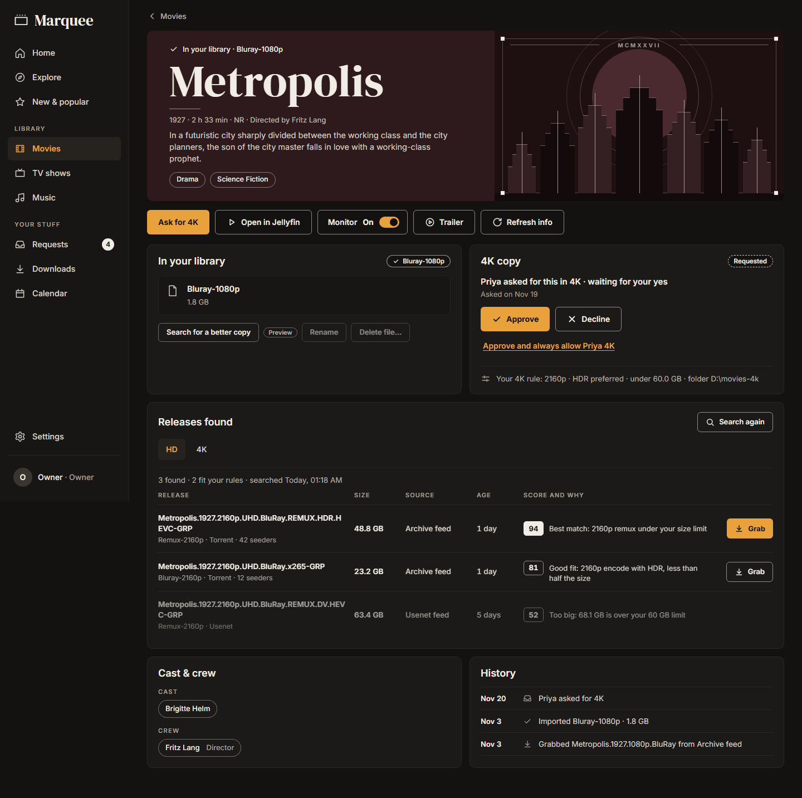
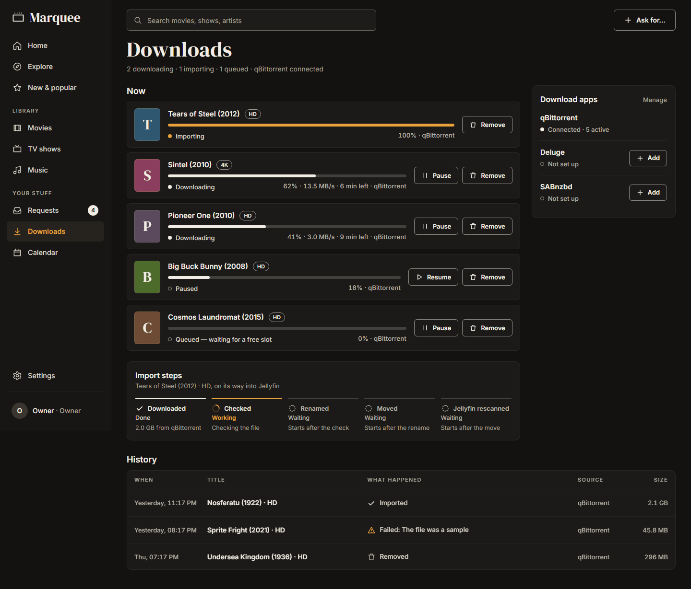
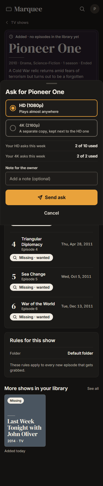

# Marquee

Marquee is one small self-hosted app for people who run their own movie, TV and music library. It does the jobs
of Sonarr, Radarr, Lidarr, Bazarr, Prowlarr and Seerr in a single program with the web page built in, and it plugs
into what you already use: qBittorrent, Deluge or SABnzbd to download, Jellyfin, Emby or Plex to watch. Friends ask
for things, you say yes, and Marquee finds, downloads, renames and files them; it never plays anything itself.



<table>
  <tr>
    <td></td>
    <td></td>
  </tr>
</table>

**Status: beta.** It works end to end, and it is young. Expect rough edges, back up your config folder before
updating, and please [open an issue](https://github.com/BaileyPillon/marquee/issues) when something is off.

## What it does

- **One program.** A single static binary with the web interface inside. No runtime, no database server, no
  separate apps to wire together.
- **Movies, TV and music** in one place: search, follow, see what is on disk and what is missing, and what airs next.
- **Requests.** Friends sign in (by invite) and ask for a movie, show or artist in HD or 4K. 4K is a separate copy in
  its own folder. Every ask can wait for your yes, or go through on its own for people you trust, and each person has
  weekly limits. You approve from your phone.
- **Plex watchlists** turn into asks by themselves, for you and your Plex friends.
- **Finds the release for you.** Add your own Torznab and Newznab feeds, or import them from Prowlarr or Jackett.
  Marquee ranks every release by your quality rules and says in plain words why it picked one or turned another down.
- **Downloads and imports.** Sends the pick to qBittorrent, Deluge or SABnzbd, follows it live, then checks it, unpacks
  it, names it, hardlinks (or moves) it into the library and tells Jellyfin, Emby or Plex to rescan. A bad release goes on
  a blocklist and the next best is tried.
- **Subtitles and music.** Subtitles by language rule, and albums grabbed, tagged and imported.
- **Your own metadata.** Your TMDB key for movies, plus keyless TVmaze and MusicBrainz. No relay in between.
- **Claude can help.** A built-in MCP server lets Claude Code search, look at your library and ask for titles, as you.
  Claude can ask but never approve, delete or change settings.
- **Phone-sized.** The web page works from a phone: ask, approve, watch downloads.
- **Alerts** to Discord, ntfy, Gotify, Telegram, Pushover, email or a webhook.
- **Languages.** The interface is built for translation: English comes first and other languages are added as catalogs.
- **Private.** No telemetry, no update check, nothing sent to the project. [Every outside host is listed](docs/privacy.md).

## Quick start

### Docker

```sh
docker run -d --name marquee --restart unless-stopped \
  -p 6464:6464 \
  -v marquee-config:/config \
  -v /srv/media:/data \
  -e TZ=America/New_York \
  ghcr.io/baileypillon/marquee:latest
```

Put your downloads and your library folders under one shared folder (`/srv/media` above) so finished downloads can be
hardlinked instead of copied. A ready [compose file](deploy/compose.yaml) with optional qBittorrent and Jellyfin is in
`deploy/`. Images are built for `amd64`, `arm64` and `arm/v7`. The image is `FROM scratch` and runs as user 65532
(there is no `PUID` or `PGID`; use compose's `user:` key, see the [install guide](docs/install.md#docker)).

### Windows

Download `marquee_<version>_windows_amd64.zip` from the [Releases page](https://github.com/BaileyPillon/marquee/releases),
unzip it, and run `marquee.exe -config D:\Marquee\config`.

### Linux

Download the `.tar.gz` for `amd64`, `arm64` or `armv7`, unpack it and run `./marquee -config /var/lib/marquee`. The
[install guide](docs/install.md#linux) has a systemd service.

### Then

Open <http://localhost:6464>. **The first person to open it becomes the owner**, so do that yourself first. Add your library
folders, a TMDB key if you want movies, a download app, and a media server, in Settings. And **back up
`marquee.key`** in the config folder: it encrypts the keys and passwords you save, and they cannot be recovered without it.

## Size

Small is a goal of the project, so the numbers are tracked. Measured on a build of this repository:

| | Size |
|---|---|
| Linux amd64 download (`.tar.gz`) | about 7 MB (budget: 17 MB) |
| The program inside it, Linux amd64 | about 16 MB |
| `marquee.exe` for Windows | about 16 MB (budget: 25 MB) |
| Docker image | about the size of the program: it holds nothing else but certificates and a licence |

## Documentation

| | |
|---|---|
| [Install](docs/install.md) | Windows, Linux, Docker and Compose, first run, backing up |
| [Configuration](docs/configuration.md) | every flag and environment variable, and an overview of Settings |
| [Connections](docs/connections.md) | download apps, media servers, sources, TMDB, subtitles, alerts, path rules |
| [Requests](docs/requests.md) | asks, 4K copies, approvals, limits, watchlists |
| [Claude and MCP](docs/claude-mcp.md) | connect Claude Code, keys and permissions, the tools |
| [Reverse proxy](docs/reverse-proxy.md) | Caddy and nginx, HTTPS, trusted proxies |
| [API](docs/api.md) | every endpoint, and how to sign in |
| [Privacy](docs/privacy.md) | every outside host, what is sent, how to turn it off |
| [Development](docs/development.md) | repository layout, running from source, tests, releases |

## Build from source

You need Go 1.27 and Node 24 (Node only builds the web page).

```sh
scripts/build.sh            # Linux, macOS or Git Bash: five platforms, SHA256SUMS and a size table in bin/
```

```powershell
.\scripts\build.ps1         # Windows: marquee.exe, plus a Linux binary and archive
```

See [Development](docs/development.md) for running from source and the tests.

## License and credits

[MIT](LICENSE).

Inspired by HolyArrs by CoderLuii. Marquee is an independent clean-room implementation and shares no code with it.
